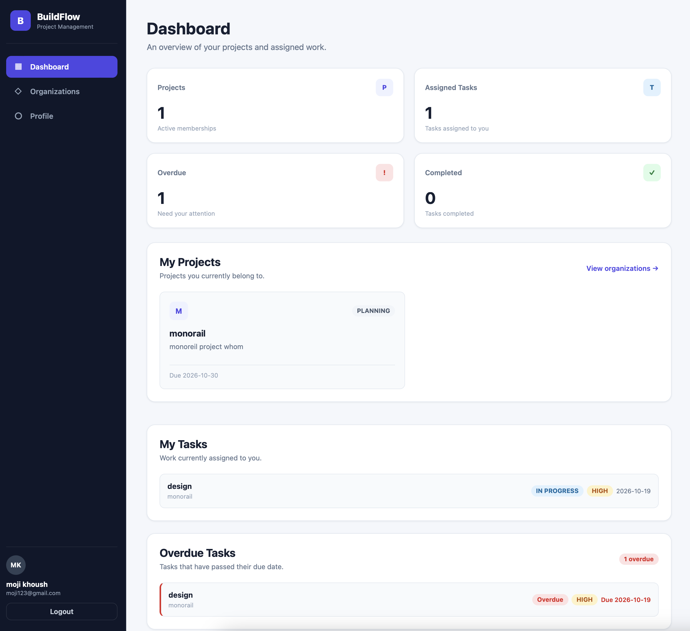
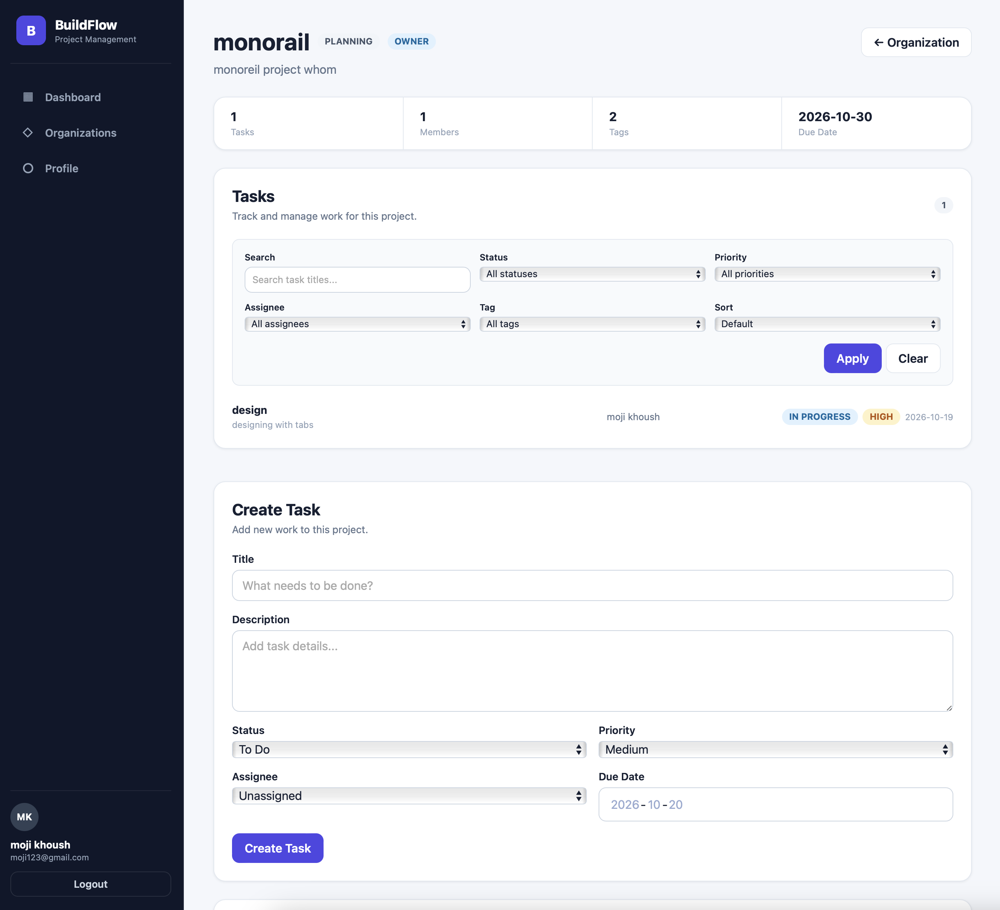
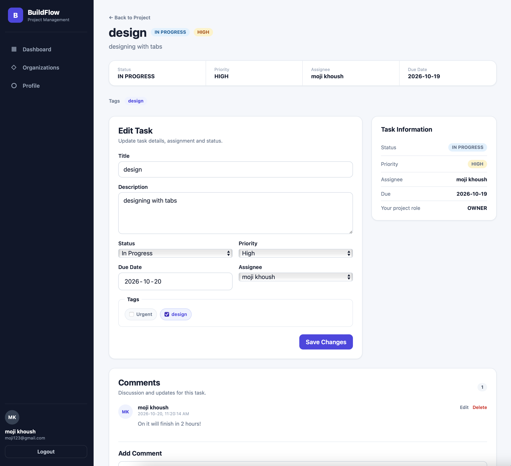

# BuildFlow

BuildFlow is a full-stack project management application designed to help organizations manage projects, team members, tasks, tags, comments, and project activity from a centralized workspace.

The application was built from scratch as a full-stack software engineering project using React, Node.js, Express, MongoDB, and JWT-based authentication.

## Screenshots

### Dashboard



### Project Management



### Task Management



## Features

- User registration and authentication
- JWT-based protected routes
- Organization management
- Organization member roles and permissions
- Project creation and management
- Project member management
- Task creation, editing, assignment, and deletion
- Task status and priority tracking
- Task search, filtering, and sorting
- Project-specific tags
- Task comments
- Activity tracking
- Role-based authorization
- Protected OWNER roles
- Cascade cleanup when projects or organizations are deleted
- Responsive user interface for desktop and smaller screens

## Role-Based Access Control

BuildFlow uses role-based authorization at both the organization and project levels.

Roles include:

- **OWNER** — full administrative control
- **ADMIN** — project and member management privileges
- **MEMBER** — standard project and task access

Authorization is enforced by the backend rather than relying only on the user interface.

## Tech Stack

### Frontend

- React
- React Router
- JavaScript
- Axios
- Vite
- HTML
- CSS

### Backend

- Node.js
- Express.js
- MongoDB
- Mongoose
- JSON Web Tokens (JWT)
- bcrypt

### Development Tools

- Git
- GitHub
- Postman

## Architecture

BuildFlow follows a REST API architecture with an MVC-style backend structure.

```text
React Frontend
      ↓
Axios / HTTP
      ↓
Express Routes
      ↓
Authentication & Authorization Middleware
      ↓
Controllers
      ↓
Mongoose Models
      ↓
MongoDB
```

The React application acts as the View layer, while the Express backend separates routing, controllers, middleware, and data models.

## Main Data Relationships

BuildFlow includes relationships between:

- Users
- Organizations
- Organization memberships
- Projects
- Project memberships
- Tasks
- Tags
- Comments
- Activity records

Membership records allow users to belong to multiple organizations and projects while maintaining different roles.

## Environment Variables

Create a `.env` file in the `backend` directory:

```env
PORT=5001
MONGO_URI=your_mongodb_connection_string
JWT_SECRET=your_jwt_secret
```

Create a `.env` file in the `frontend` directory:

```env
VITE_API_URL=http://localhost:5001
```

Example environment files are included in the repository.

## Running the Application Locally

### 1. Clone the repository

```bash
git clone https://github.com/manishadman/build-flow.git
cd build-flow
```

### 2. Install backend dependencies

```bash
cd backend
npm install
```

### 3. Install frontend dependencies

```bash
cd ../frontend
npm install
```

### 4. Configure environment variables

Create the backend and frontend `.env` files using the included `.env.example` files as templates.

### 5. Start the backend

From the `backend` directory:

```bash
npm run dev
```

### 6. Start the frontend

From the `frontend` directory:

```bash
npm run dev
```

Then open the local URL provided by Vite.

## Security

BuildFlow includes:

- Password hashing with bcrypt
- JWT authentication
- Protected API routes
- Backend role-based authorization
- Organization and project membership validation
- Ownership protection
- Cross-project data validation
- Environment variables for sensitive configuration

Real environment files and credentials are excluded from Git.

## Project Status

BuildFlow V1 is complete.

The application includes a functional full-stack workflow covering authentication, organizations, projects, memberships, tasks, tags, comments, permissions, responsive UI, and data cleanup.

## Author

**Mani Shadman**

Software Developer | Full-Stack Developer

[LinkedIn](https://www.linkedin.com/in/mani-shadman/)
